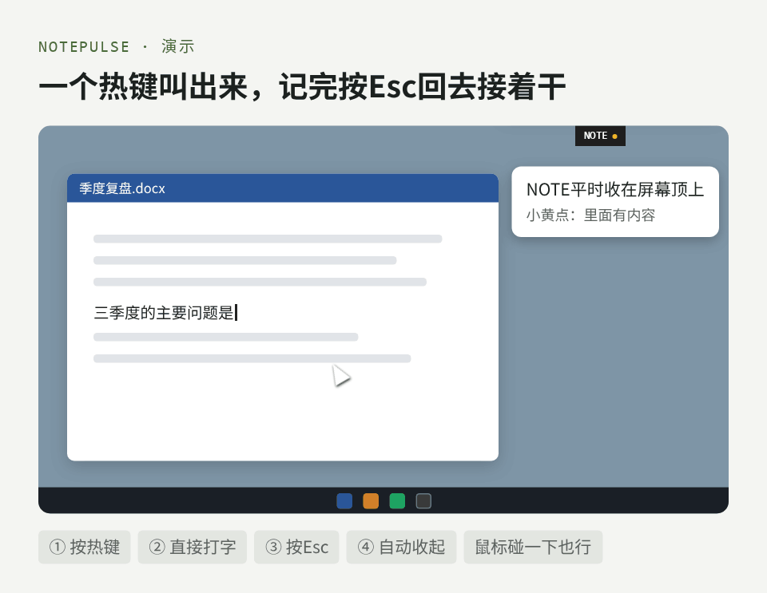
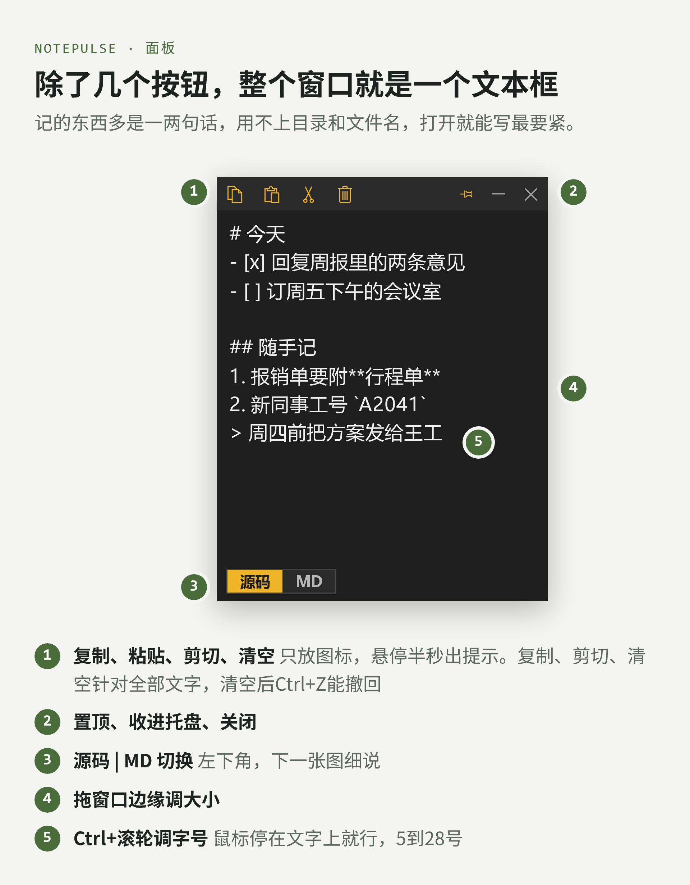
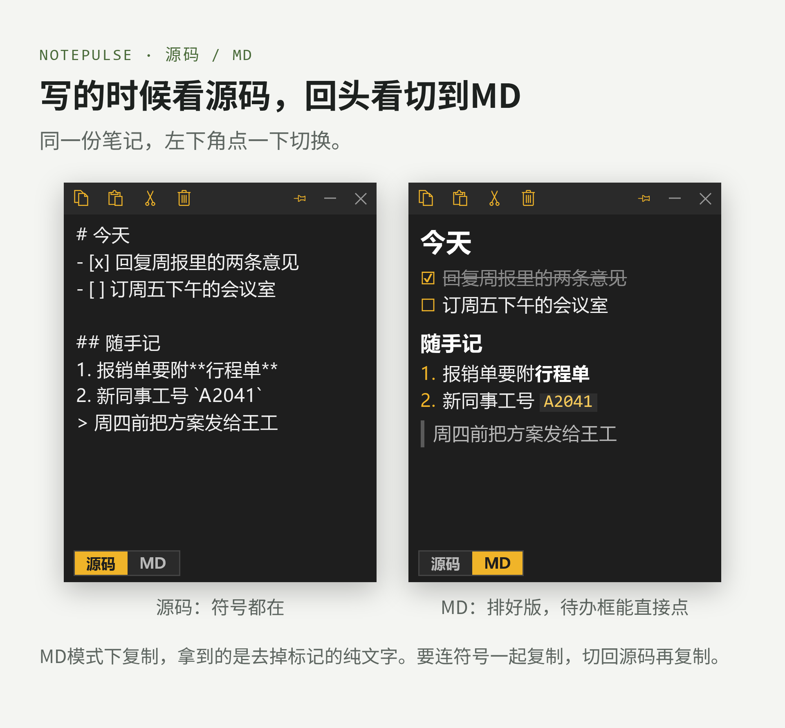

# NotePulse

贴在屏幕边上的记事本。不用的时候只露一个 `NOTE` 小标签，按一下热键或鼠标碰一下就弹出来，记完按 Esc 回到刚才的窗口接着干活。

> A tiny always-at-hand notepad for Windows: docks to a screen edge, pops up with a global hotkey (Left Ctrl + Left Alt + N), Esc returns focus to where you were. Plain text or rendered Markdown. Standard library only.



> 演示动图为示意，节奏放慢了，数据为示例。

## 功能

- **全局热键 左Ctrl+左Alt+N**：在任何程序里按下，记事本弹到前台，光标停在文末，直接打字。只认左手这一组，右侧 Ctrl / Alt 不触发。已在前台时再按一次则收起
- **Esc 还焦点**：记完按 Esc，焦点回到进记事本之前的那个窗口（源码 / MD 两种模式都生效）
- **贴边收起**：拖到屏幕左、右或上边缘松手即吸附，鼠标离开且焦点不在记事本时，缩成 `NOTE` 标签；里面有内容时标签旁亮一个黄点。鼠标在标签上停一下展开：标签先亮一圈边，再从标签的大小长成面板，内容随之淡入；收起时反过来
- **整个窗口就是文本框**：标题栏只有复制 / 粘贴 / 剪切 / 清空四个图标（悬停出文字提示）。复制、剪切、清空作用于全部文字，粘贴插到光标处；清空不弹确认，Ctrl+Z 撤回
- **拖边缘调大小**，**Ctrl+滚轮调字号**（鼠标停在文字上即可，5–28 号）
- **源码 / MD 切换**（左下角）：MD 模式只读、排好版，待办框可直接点勾；双击回到源码并定位到该行。MD 模式下复制得到去掉标记的纯文字，要带符号复制就切回源码
- **自动保存**：停手 0.4 秒写入本地文件，关掉再开内容还在
- 置顶开关、系统托盘图标、单实例





### 支持的 Markdown

`#` / `##` / `###` 标题、`-` / `*` 无序列表（缩进分级）、`1.` 有序列表、`- [ ]` / `- [x]` 待办、`>` 引用、```` ``` ```` 代码块、`---` 分隔线；行内 `**粗体**`、`*斜体*`、`` `代码` ``、`~~删除线~~`、`[文字](链接)`（只显示文字）。

不支持表格、图片、HTML 和嵌套的行内样式。

## 下载

不想装 Python：到 [Releases](https://github.com/liuzhaowei1/notepulse/releases) 下载 `NotePulse.exe`，双击即用。exe 由 PyInstaller 打包，部分杀毒软件可能误报；不放心可按下文用源码运行或自行打包。

想开机自启：按 Win+R 输入 `shell:startup`，把 `NotePulse.exe` 的快捷方式放进打开的文件夹。

## 使用

需要 Windows 和 Python 3（带 tkinter；作者环境为 Python 3.10）。无第三方依赖。

```
python notepulse_app.py
```

如果热键被别的程序占用，窗口底部会提示，记事本其余功能照常可用。

### 打包成 exe

```
pip install pyinstaller
python -m PyInstaller --onefile --windowed --name NotePulse --icon assets/app.ico --add-data "assets/app.ico;assets" --noconfirm --clean notepulse_app.py
```

产物在 `dist/NotePulse.exe`。

## 数据存在哪

都在 `%LOCALAPPDATA%\NotePulse\`：

- `note.md`：正文，纯文本，可以直接用别的编辑器打开
- `config.json`：窗口位置和大小、置顶开关、贴边位置、字号、显示模式

不联网，不收集任何数据。

## 想改成自己的

- 热键：`notepulse_app.py` 里搜 `HOTKEY_TEXT` 和注册热键的那几行（`MOD_CONTROL | MOD_ALT` + `N`，以及只认左侧键的过滤）
- 收起标签的文字：`TAB_TEXT`
- 展开 / 收起的过渡：`DOCK_MORPH` 关掉则改回直接滑出，时长见 `MORPH_EXPAND_MS` / `MORPH_COLLAPSE_MS`
- 配色：文件开头的 `T` 字典

## 开发

```
python test_logic.py      # 纯逻辑单测（Markdown 解析、调大小、贴边几何、配置读写），不开窗口，通过输出 ALL PASS
python make_icon.py       # 重新生成 assets/app.ico（需要本机装有 Edge），一般不需要
```

## 同族工具

同一套窗口风格与贴边收起逻辑：

- [CC Pulse](https://github.com/liuzhaowei1/cc-pulse)：同时开多个 Claude Code 会话时，看哪个在跑、哪个跑完、哪个在等你
- [NetCheck](https://github.com/liuzhaowei1/netcheck)：一键看代理出口在哪个城市、通不通、多快

## License

MIT
